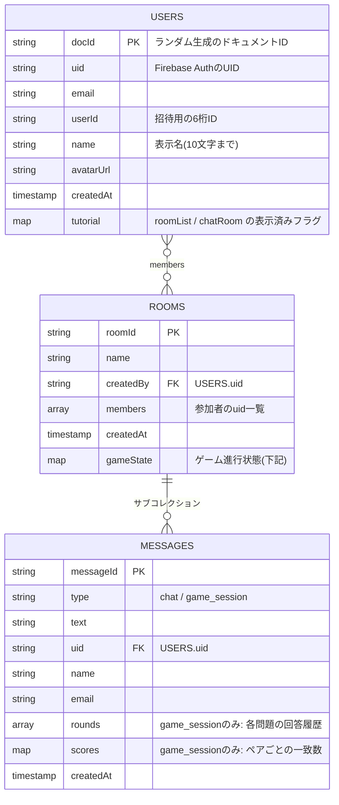
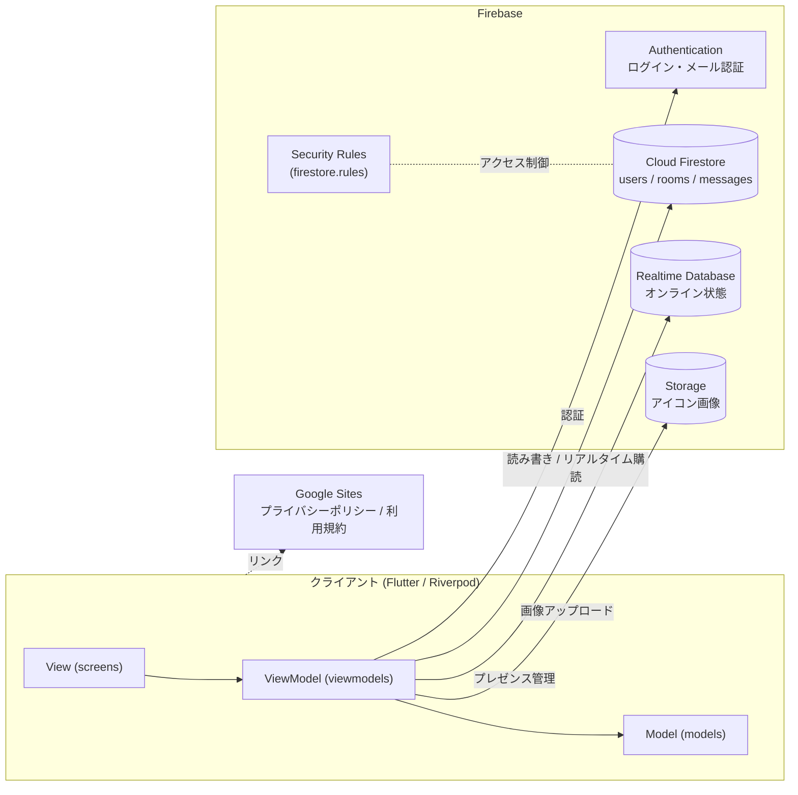

# ぴたルム

> 友達と「共通点」を探して、相性が"ぴたっ"と分かるチャット＆診断ゲームアプリ

<!-- TODO: サービスの雰囲気が伝わる画像(スクリーンショットやGIF)を docs/images/ に置いて差し替えてください -->
<p align="center">
  
  
</p>

<!-- 例:    -->

---

## サービスURL

<!-- TODO: 公開しているURL(Webアプリ / ストアのURLなど)を記入 -->
- アプリ: 準備中

関連ページ
- [プライバシーポリシー](https://sites.google.com/st.kobedenshi.ac.jp/pitarm)
- [利用規約](https://sites.google.com/st.kobedenshi.ac.jp/pitarm-kiyaku)

## 関連記事

<!-- TODO: Qiita / Zenn / note などの記事URLを記入 -->
- 準備中

---

## サービス概要

ぴたルムは、友達とチャットルームに集まり、**同じ質問に答えて「回答がどれだけ一致したか」で相性を診断する**アプリです。

1. ルームを作って、招待IDで友達を呼ぶ
2. ルームにいるメンバー全員で「ゲーム」を開始する
3. 「好きな食べ物は？」などの4択の質問に、みんなが同時に答える(全5問)
4. 回答が一致するとペアのスコアが加算され、結果発表で**2人ずつの一致率**がわかる
5. 結果はチャットに残り、あとから見返せる

普段のチャットも同じルーム内で行えるので、「雑談 → ゲームで盛り上がる → また雑談」という流れが自然に続きます。

## 開発の背景

<!-- TODO: 以下は仮の文章です。実際の動機(誰のどんな課題を解決したかったか)に書き換えてください -->
- 友達や初対面の人と話すとき、「何を話せばいいか分からない」「共通点が見つからない」と感じることがある
- 質問に答えるだけなら気軽に参加でき、結果が数字で出るので会話のきっかけになる
- 「診断結果で盛り上がる」ことを目的に、リアルタイム通信で全員が同時に遊べるチャット機能と組み合わせたアプリとして開発した

---

## 画面・機能の説明

<!-- TODO: 各項目にスクリーンショットを追加すると伝わりやすくなります -->

| 画面 | 説明 |
| --- | --- |
| 新規登録 / ログイン | メールアドレスとパスワードで登録。登録後は確認メールによるメール認証が必要。パスワードの再設定にも対応 |
| プロフィール設定 | 初回ログイン時に表示名(10文字まで)を設定 |
| ルーム一覧 | 参加中のルームを一覧表示。初回のみ、フェアリーが使い方を案内するチュートリアルを表示 |
| ルーム作成 | 部屋名を決めてチャットルームを作成 |
| ユーザー招待 | 相手の「招待ID(6桁)」を入力してルームに追加。自分の招待IDはプロフィール画面からコピーできる |
| チャット | ルーム内でメッセージを送受信。オンラインのメンバー数を表示。ルーム名の変更・退会もここから |
| 共通点探しゲーム | 2人以上がオンラインなら開始可能。5つのカテゴリ(食べ物 / 趣味 / 日常 / 価値観 / もしも)・計100問からランダムに5問を出題し、全員が回答すると次の問題へ進む |
| 結果発表 | 2人ずつのペアで回答の一致率を表示し、フェアリーがコメント。全員が結果を閉じるとチャットに履歴として保存される |
| プロフィール | アイコン・表示名の編集、招待IDの確認、プライバシーポリシー・利用規約、アカウント削除(パスワード再認証あり) |

### 工夫したポイント

- **同時回答の整合性**: 複数人が同時に回答しても「全員回答済み」の判定がずれないよう、Firestoreのトランザクションで回答を記録
- **オンライン判定**: Realtime Database をプレゼンス管理に使い、ルームを開いているメンバーだけをゲーム参加者として扱う(切断時は自動でオフラインに)
- **アカウント削除**: 参加中ルームからの退会、最後の1人ならルームとメッセージの削除、アイコン画像の削除まで一括で行う
- **MVVM構成**: View(`screens/`)は表示のみ、処理は ViewModel(`viewmodels/`)に集約 → [lib配下のフォルダ構成](docs/lib-structure.md)

---

## 主な使用技術

| 分類 | 技術 |
| --- | --- |
| フレームワーク / 言語 | Flutter / Dart (SDK ^3.9.2) |
| 状態管理 | Riverpod (`flutter_riverpod`) |
| 認証 | Firebase Authentication (メール / パスワード、メール認証) |
| データベース | Cloud Firestore (ユーザー・ルーム・メッセージ・ゲーム進行状態) |
| リアルタイムDB | Firebase Realtime Database (オンライン状態の管理) |
| ストレージ | Firebase Storage (アイコン画像) |
| その他パッケージ | `image_picker` / `url_launcher` / `google_fonts` / `tutorial_coach_mark` |
| 対応プラットフォーム | Android / iOS / Web / Windows / macOS / Linux |
| アーキテクチャ | MVVM (models / viewmodels / screens) |

## ER図

Firestore のコレクション構成です。



`ROOMS.gameState` の中身

| フィールド | 内容 |
| --- | --- |
| `status` | `waiting`(待機) / `playing`(出題中) / `result`(結果発表) |
| `currentQuestion` / `totalQuestions` | 現在の問題番号 / 出題数(5) |
| `questionIndices` | 開始時にランダム抽選した問題のインデックス |
| `answers` | `{uid: 選んだ選択肢}` |
| `scores` | `{"uidA_uidB": 一致した回数}` |
| `activeMembers` / `closedMembers` | ゲーム参加者 / 結果画面を閉じたメンバー |
| `rounds` | 各問題の回答履歴 |

その他
- **Realtime Database**: `rooms/{roomId}/activeMembers/{uid}` にオンライン状態を保持
- **Storage**: `avatars/{uid}.jpg` にアイコン画像を保存
- 問題データ(100問)はアプリ内の定数(`lib/data/questions.dart`)として保持

## インフラ構成図

アプリはクライアント完結型で、バックエンドは Firebase のマネージドサービスを利用しています。独自のサーバーは持ちません。



## セットアップ

```bash
git clone https://github.com/miyabot/flutter_bomb_chat_app.git
cd flutter_bomb_chat_app
flutter pub get
flutter run
```

Firebase プロジェクトは FlutterFire CLI で設定済みです(`lib/firebase_options.dart`)。自分の Firebase プロジェクトで動かす場合は `flutterfire configure` を実行し、Authentication(メール/パスワード)・Firestore・Realtime Database・Storage を有効化して、`firestore.rules` を反映してください。

---

## 今後の展望

<!-- TODO: 実際の計画に合わせて編集してください。以下はコードから想定した案です -->
- [ ] 問題の追加・カテゴリ選択(ルームごとにカテゴリを選べるようにする)
- [ ] 問題データを Firestore で管理し、アプリ更新なしで追加できるようにする
- [ ] プッシュ通知(ゲーム開始・メッセージ受信のお知らせ)
- [ ] 画像・スタンプの送信
- [ ] 相性ランキングや過去の結果の振り返り機能
- [ ] テストコードの拡充(現在は `test/widget_test.dart` のみ)
